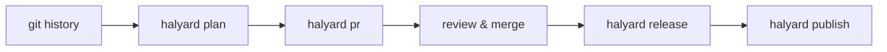

<div align="center">

  <p>
    <strong>A zero-config release engine for Cargo and pnpm monorepos, written in Rust.</strong><br/>
    Halyard reads your git history, computes the next version for every package from conventional commits, and opens a Release PR you review before tagging and publishing. It is built for maintainers of monorepos that span Rust and Node, where release-please, changesets, and release-plz each cover half the problem. Every stage has a dry-run mode, so you can see exactly what will happen before anything is written.
  </p>
  <p>
    <a href="https://github.com/elcoosp/halyard/actions"></a>
    <a href="https://github.com/elcoosp/halyard/blob/main/LICENSE"></a>
    <a href="https://www.rust-lang.org"></a>
    <a href="#status"></a>
  </p>
  <p>
    <a href="#quickstart">Quickstart</a> •
    <a href="#features">Features</a> •
    <a href="#usage">Usage</a> •
    <a href="docs/HALYARD_ARCHITECTURE.md">Architecture</a>
  </p>
</div>



## Quickstart

Requires a stable Rust toolchain.

```bash
# install from git (pre-1.0; crates.io release pending)
cargo install --git https://github.com/elcoosp/halyard --package halyard-cli --locked

cd your-monorepo
halyard plan      # works with zero config in standard Cargo + pnpm layouts
halyard init      # optional: scaffold halyard.toml to customize
```

`halyard plan` prints each package's next version, the changelog preview, and the files it would edit. When the plan looks right, `halyard pr` opens the Release PR; after it merges, `halyard release` creates the tags and `halyard publish` ships to the registries.

<details>
<summary>Build from source instead</summary>

```bash
git clone https://github.com/elcoosp/halyard.git
cd halyard
cargo build --release
./target/release/halyard plan
```

</details>

## Features

- **Polyglot by design**: one plan covers Cargo crates and npm/pnpm packages in the same monorepo, with a single version graph and reverse-dependency closure.
- **Deterministic plans**: the plan is a pure function of the git history, the workspace, and `halyard.toml`, hashed with blake3. Same inputs, same `plan_hash` — CI can gate on it.
- **Dry-run everywhere**: `plan`, `apply`, `pr`, `release`, and `publish` all support `--dry`, backed by a preview forge and a preview tag writer that never touch the network or the working tree.
- **Verified Release PRs**: the PR body embeds the plan (canonical JSON, DEFLATE, base64), so `halyard release` verifies the PR it releases matches the plan it computed.
- **Conventional-commit native**: spec-compliant 1.0.0 parser (scopes, breaking-change footers, `(#NNN)` PR extraction, `fixup!`/`squash!` detection), plus optional `.halyard/changes/*.md` change files for squash-merge workflows.
- **Affected-package selection**: `halyard affected` answers "which packages must rebuild and test?" and renders the answer in your CI's own grammar — turbo, nx, bazel, GitHub Actions, GitLab, Azure, TeamCity, CircleCI, Buildkite, Jenkins, Bitbucket, Drone.
- **PyPI/uv workspaces supported (M8 step 1+2)**: the same plan covers `pyproject.toml` PEP 621 projects in uv workspaces — `[tool.uv.sources]` workspace rows resolve like cargo path deps, the PEP 440 strategy plans canonical spellings (`1.2.3rc1` ⇄ `1.2.3-rc.1`) and fails closed on the recognized-but-non-canonical ones (epoch/post/dev/local, implicit segments — warned, unpublishable, never rewritten), `halyard publish` rides `uv publish` (the bare argv; `UV_PUBLISH_TOKEN` through the auth seam), and the PyPI JSON API backs the resume/visibility probes.
- **Migration path**: `halyard migrate` surveys release-please, changesets, knope, and release-plz configs, reports semantic differences, and writes a reviewed `halyard.toml` — create-only, so existing configs are never clobbered.
- **Ship a release step, not a setup script**: the composite GitHub Action (`action/action.yml`) resolves the runner platform, downloads the pinned static release binary, verifies the checksum manifest **and** the build attestation **and** the cosign signature (`gh attestation verify` + `cosign verify-blob`, keyless, pinned to halyard's own workflow identity), caches by version, and execs `halyard action` — every piece pinned to one grammar by `cargo run -p xtask -- check-release`. The release pipeline (`/.github/workflows/release.yml`) signs every release asset keylessly and ships a signed CycloneDX SBOM of the shipped binary's dependency graph. GitLab pipelines include the same release step as a CI component (`templates/halyard.yml`), checksum-verified from the same release set.
- **GitHub and GitLab and Forgejo/Gitea and Bitbucket supported**: the Release PR flow runs on GitHub, GitLab (M7 step 1), and Forgejo/Gitea — codeberg.org and gitea.com, self-hosted via `FORGEJO_API_URL` (M7 step 2) — MRs/pulls instead of PRs, the same §11.1 machine, backed by the shared forge conformance suite every adapter passes.

## How it works

Halyard is a layered Rust workspace. `halyard-core` holds the pure types and the plan contract (no I/O); the parser, version algebra, and edit engine sit above it; ecosystem adapters (`halyard-eco-cargo`, `halyard-eco-npm`, `halyard-eco-pypi`) and the git engine (`halyard-git`) sit above those; the forge, registry, publish, and action layers are driven through narrow seams (`Forge`, `Registry`, `PublishEffect`, `PublishAuth`, `ActionWriter`) so the real network adapters and the preview adapters are interchangeable. The layering is enforced by `cargo run -p xtask -- check-layers`.

The full architecture and the milestone plan live in [`docs/HALYARD_ARCHITECTURE.md`](docs/HALYARD_ARCHITECTURE.md); progress is tracked in [`PROGRESS.md`](PROGRESS.md).

<details>
<summary>Workspace layout</summary>

| Crate                  | Role                                                                  |
| ---------------------- | --------------------------------------------------------------------- |
| `halyard-core`         | pure core types, plan contract, plan hash (no I/O)                    |
| `halyard-config`       | `halyard.toml` loader + layered resolution + foreign-config migration |
| `halyard-conventional` | conventional-commit parser (winnow, zero-copy)                        |
| `halyard-version`      | bump algebra, 0.x policy, requirement rewriter                        |
| `halyard-edit`         | byte-range patches, atomic apply, verify-before-write                 |
| `halyard-discover`     | topology + manifests → workspace                                      |
| `halyard-eco-cargo`    | Cargo adapter: discovery, manifest + lockfile patchers                |
| `halyard-eco-npm`      | npm/pnpm adapter: discovery, JSON edit, pnpm-lock patcher             |
| `halyard-eco-pypi`     | PyPI/uv adapter: PEP 621 discovery, PEP 440 strategy, pyproject edits |
| `halyard-git`          | gix engine: refs, history walk, tag phase, push, smart fetch          |
| `halyard-cache`        | persistent mmap per-commit cache                                      |
| `halyard-changelog`    | changelog styles, Release PR body, change-file grammar                |
| `halyard-forge`        | `Forge` seam + `MemoryForge` + `PreviewForge` + release state machine |
| `halyard-forge-github` | GitHub REST adapter + App-JWT auth                                    |
| `halyard-forge-gitlab` | GitLab REST adapter (MR flow) — M7 step 1                             |
| `halyard-forge-forgejo` | Forgejo/Gitea REST adapter (pull flow) — M7 step 2                   |
| `halyard-registry`     | crates.io sparse index + npm packument + PyPI JSON-API probes         |
| `halyard-publish`      | publish engine: plan validation, topological layers, resume, auth     |
| `halyard-action`       | GitHub Actions outputs over `GITHUB_OUTPUT`/`GITHUB_STEP_SUMMARY`     |
| `halyard-cli`          | the `halyard` shell                                                   |

Plus `halyard-test-support` (fixtures) and `xtask` (workspace tooling).

</details>

## Usage

### Preview, open, release, publish

```bash
halyard plan            # what would change, and why
halyard pr --dry        # forecast the Release PR (no network)
halyard pr              # open or update the Release PR
halyard release --dry   # forecast tags and GitHub releases
halyard release         # create tags, push, create GitHub releases
halyard publish --dry   # forecast registry publishes
halyard publish         # publish to crates.io / npm
```

### In CI: select only the affected packages

```bash
halyard affected --base "$GITHUB_BASE_REF" --ci github-actions
```

`--ci` takes `turbo`, `nx`, `bazel`, `github-actions`, `gitlab`, `azure`, `teamcity`, `circleci`, `buildkite`, `jenkins`, `bitbucket`, or `drone`, and prints the selection in that system's matrix grammar.

### Try it on an existing release-please / changesets repo

```bash
halyard migrate         # survey existing configs, print a draft halyard.toml
halyard migrate --write # land the reviewed draft, create-only
```

### Going further

Every crate ships runnable examples:

```bash
cargo run -p halyard-forge --example release_machine
cargo run -p halyard-forge --example content_commit
cargo run -p halyard-publish --example publish_plan
cargo run -p halyard-cli --example release_pipeline
cargo run -p halyard-eco-pypi --example scan_pyproject
cargo run -p halyard-action --example auto_forecast
cargo run -p halyard-action --example distribution_plan
```

## Compared to alternatives

release-please, release-plz, and changesets are mature tools. If your monorepo is single-ecosystem, one of them is likely the simpler choice. Halyard is for repos that span both Rust and Node: it plans and ships Cargo crates and npm/pnpm packages from the same conventional-commit history, with one dry-run preview, one Release PR, and one publish step. The `migrate` command reads existing release-please, changesets, knope, and release-plz configs and drafts a `halyard.toml`, so you can evaluate it without committing.

## Status

> [!NOTE]
> Halyard is pre-1.0 and under active development. The planning, edit, git, forge, registry, and publish layers are landed and tested; the CLI surface is stabilizing but may change between minor versions. See [`PROGRESS.md`](PROGRESS.md) for the milestone log.

Supported platforms follow the CI matrix: Linux, macOS, and Windows.

## Learn more

- [Architecture and master plan](docs/HALYARD_ARCHITECTURE.md)
- [Milestone progress](PROGRESS.md)
- [Stability contract](docs/stability.md) — what a consumer may hold halyard to across releases (M6.4)
- [Docs site](docs/site/src/SUMMARY.md) — quickstart, concepts, and reference as a book (`mdbook build docs/site`; link-gated by `cargo run -p xtask -- check-docs-site`)
- [Runnable examples](crates/) — each crate has an `examples/` directory
